# 李宏毅《机器学习》课程笔记

## 1 机器学习与深度学习基础

### 1.1 从任务到函数

给定输入 $x$，模型 $f_\theta$ 产生预测 $\hat y=f_\theta(x)$，$\theta$ 是可学习参数。机器学习通过数据和训练目标选择参数，使模型对未见样本也有效。深度学习是机器学习的一类方法，常用多层神经网络学习表示；“多层”不保证在所有任务上都更好。

| 任务 | 预测对象 | 示例 | 常见输出与目标 |
| --- | --- | --- | --- |
| 回归 Regression | 连续数值 | 房价、未来温度 | 实数或实向量；MAE、MSE |
| 分类 Classification | 离散类别 | 情感、音素类别 | 类别概率；交叉熵 |
| 结构化预测 Structured Prediction | 存在内部关系的结构 | 翻译序列、语法树 | 序列或其他结构；目标依任务定义 |

分类模型也会输出数值，但数值通常表示类别分数或概率，因此不能仅凭“输出是数字”判断它是回归。逻辑回归虽然名称含“回归”，通常解决分类问题。

监督学习使用外部提供的目标，例如人工标签。自监督学习从数据自身构造训练目标，例如遮住词再预测该词；它不是“没有训练目标”。预训练描述训练阶段，自监督描述信号来源，二者不能直接画等号。

### 1.2 三个基本步骤与损失函数

先选择函数族，再定义好坏的度量，最后优化参数。给定 $N$ 个样本，经验损失为：

$$
L(\theta)=\frac{1}{N}\sum_{i=1}^{N}\ell(f_\theta(x_i),y_i).
$$

其中 $y_i$ 统一表示真实目标，$\hat y_i$ 表示预测。

$$
\operatorname{MAE}=\frac1N\sum_i|\hat y_i-y_i|,
\qquad
\operatorname{MSE}=\frac1N\sum_i(\hat y_i-y_i)^2.
$$

平方误差会更强烈地惩罚大的残差；绝对误差在零残差处不可微，但可以使用次梯度。损失函数需要与任务和优化性质匹配，训练损失与最终业务指标也可能不同。

二分类令 $p=\sigma(z)$、$y\in\{0,1\}$，常用二元交叉熵：

$$
\ell_{\mathrm{BCE}}(p,y)=-y\log p-(1-y)\log(1-p).
$$

多分类令 $z_c$ 为第 $c$ 类 logit，Softmax 及交叉熵为：

$$
p_c=\frac{\exp z_c}{\sum_{j=1}^{C}\exp z_j},
\qquad \ell_{\mathrm{CE}}=-\sum_{c=1}^{C}y_c\log p_c.
$$

对单个正确类别 $k$，one-hot 标签使损失简化为 $-\log p_k$。在 Sigmoid 与 BCE、Softmax 与 CE 的标准配对下，对 logit 的导数具有“预测减目标”的形式，便于理解为何损失选择会影响梯度。相比之下，对 Sigmoid 输出使用 MSE 时，导数会额外包含 $p(1-p)$，在饱和区可能很小；不能据此断言 MSE 无法分类。

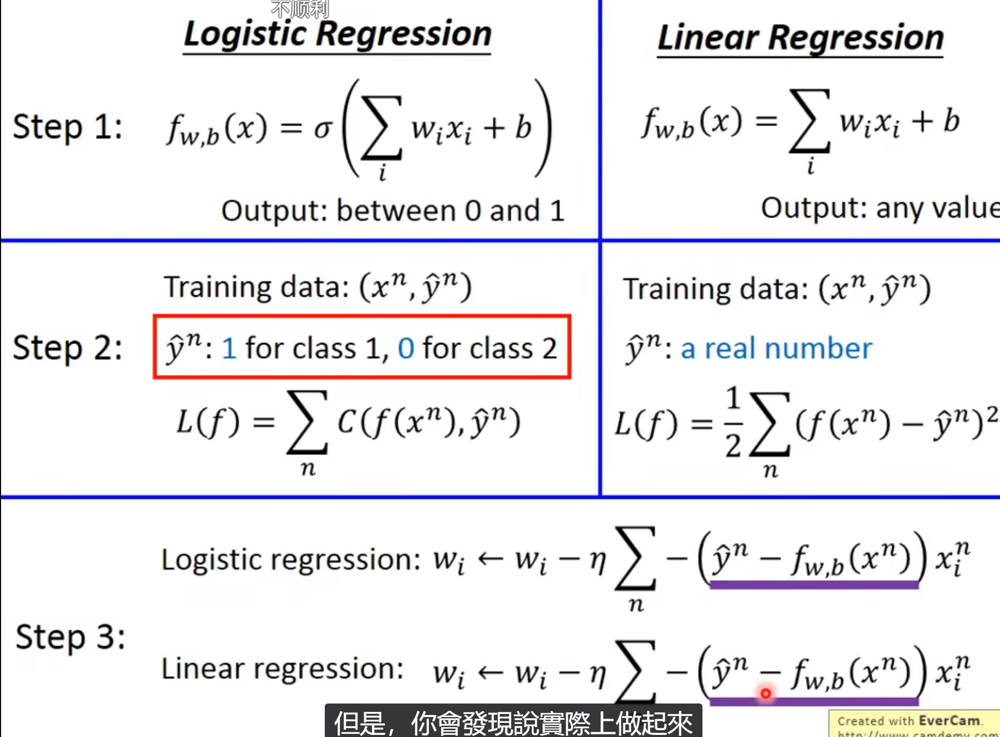

图中左侧使用 Sigmoid，右侧使用线性输出。两类问题都遵循“函数、损失、优化”三个步骤；即便更新表达式看起来相近，预测的含义与损失的定义仍不同。

### 1.3 神经网络与非线性激活

一个全连接层可写为 $h=\phi(Wx+b)$。多层网络将这些变换复合起来。若所有激活都是线性的，多层仿射变换仍可合并成一层，因此非线性是增加表达能力的重要来源。

| 激活 | 定义 | 作用与限制 |
| --- | --- | --- |
| Sigmoid | $\sigma(z)=1/(1+e^{-z})$ | 输出在 0 与 1 之间；常用于二分类或门控，大幅正负输入处容易饱和 |
| Tanh | $\tanh z$ | 输出在 −1 与 1 之间；常用于循环网络候选状态，同样存在饱和区 |
| ReLU | $\max(0,z)$ | 正半轴导数为 1；负半轴梯度为 0，可能出现长期不激活的单元 |

一维、有限折点的连续分段线性函数，可以用仿射项和若干带平移的 ReLU 精确表示，例如

$$
f(x)=a+bx+\sum_{j=1}^{m}c_j\operatorname{ReLU}(x-t_j).
$$

系数 $c_j$ 调整折点 $t_j$ 处的斜率变化。

### 1.4 梯度下降、Batch、Epoch 与 Iteration

梯度下降的基本更新为：

$$
\theta_{t+1}=\theta_t-\eta_t\nabla_\theta L(\theta_t).
$$

随机性通常来自参数初始化、数据抽样或打乱，不是每一步“随机选择一个权重”。普通反向传播会计算所有参与目标的可训练参数的梯度，优化器按规则更新它们。

| 方法或单位 | 含义 |
| --- | --- |
| 全批量梯度下降 | 一次更新使用整个训练集的梯度 |
| SGD，严格意义 | 一次更新使用一个随机样本的梯度 |
| Mini-batch SGD | 一次更新使用一个小批量；工程中经常也简称 SGD |
| Batch size $B$ | 一批中的样本数，具体任务也可能按 token 数组织批次 |
| Iteration / step | 通常指处理一个 batch；若有梯度累积，若干 iteration 才执行一次参数更新 |
| Epoch | 常规有限数据集训练中，遍历一次训练数据 |

不丢弃尾批、无梯度累积时，一个 epoch 有 $\lceil N/B\rceil$ 次更新。例如 $N=1000,B=128$，共 8 批，末批为 104 个样本；若设置丢弃尾批，则只有 7 次更新。应写明计数约定。

常规独立样本训练往往在每个 epoch 重新打乱样本并分批，不仅仅是“打乱已有 batch 的顺序”。时间序列、保持隐藏状态的训练或特殊采样器可能不能任意打乱。

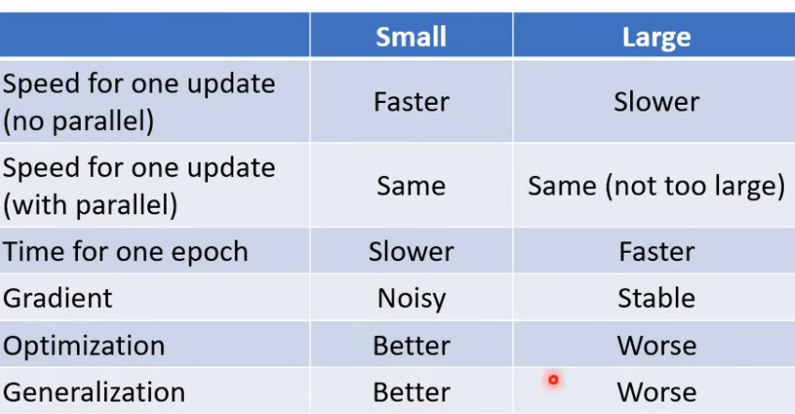

图中比较每次更新、每个 epoch、梯度噪声和泛化。它是特定训练条件下的经验概括：批量增大可能提高硬件利用率，但会增加显存需求；小批量噪声有时有助于探索，也可能妨碍收敛。图中的 Better/Worse 不能视为对所有模型、硬件和学习率配置成立的定理。

### 1.5 反向传播：链式法则计算梯度

前向传播计算预测与损失；反向传播复用中间量，从损失沿计算图反向应用链式法则。**反向传播负责求梯度，优化器负责用梯度更新参数。**

以列向量约定，设第 $l$ 层 $z^{(l)}=W^{(l)}a^{(l-1)}+b^{(l)}$，$a^{(l)}=\phi_l(z^{(l)})$，定义 $\delta^{(l)}=\partial L/\partial z^{(l)}$。隐藏层有：

$$
\delta^{(l)}=\left((W^{(l+1)})^T\delta^{(l+1)}\right)\odot\phi'_l(z^{(l)}).
$$

$$
\frac{\partial L}{\partial W^{(l)}}=\delta^{(l)}(a^{(l-1)})^T,
\qquad \frac{\partial L}{\partial b^{(l)}}=\delta^{(l)}.
$$

$\odot$ 为逐元素乘法；以上是单样本公式，批量损失按约定求和或平均。输出层的初始 $\delta$ 由输出激活和损失共同决定，不能无条件套用隐藏层的形式。

例如标量网络 $z=wx+b$、$a=\operatorname{ReLU}(z)$、$L=(a-y)^2/2$，当 $z>0$ 时 $\partial L/\partial w=(a-y)x$，当 $z<0$ 时这条分支的梯度为 0；在 $z=0$ 采用实现定义的次梯度约定。

较深网络中的梯度包含多层 Jacobian 的连乘，可能缩小或放大。合适初始化、激活函数、残差路径、归一化等可以改善训练；梯度裁剪限制过大的梯度范数，但不直接解决梯度消失。

## 2 训练诊断、泛化与优化

### 2.1 先看训练误差，再看泛化误差

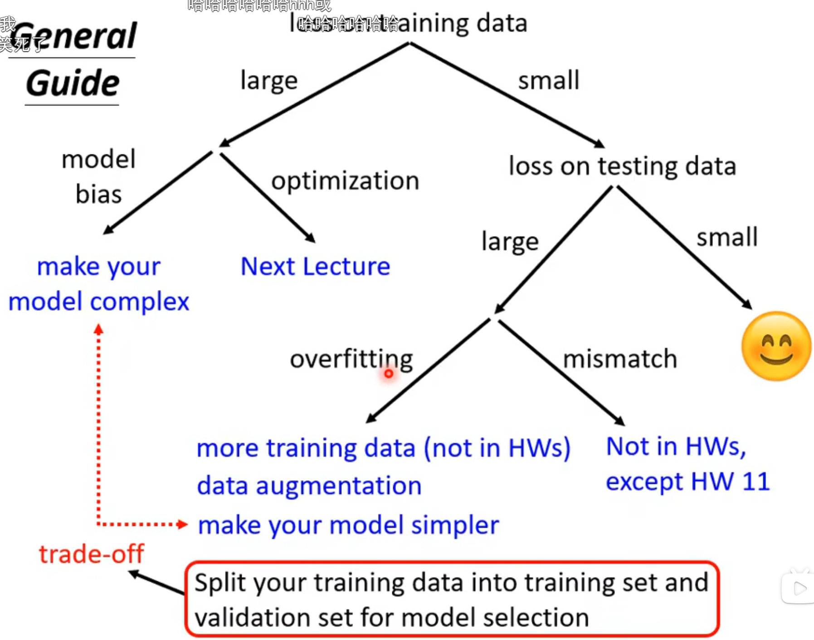

这张图把问题分成两层。训练误差已经很高时，先分辨模型表达能力不足还是优化没有做好；训练误差低、验证表现差时，再检查过拟合、分布差异或评估流程。图中写 testing data，实际模型选择应使用验证集，不能反复根据最终测试集调参。

| 问题 | 典型信号 | 可能的处理方向 |
| --- | --- | --- |
| Model bias / 欠拟合 | 训练与验证都差，简单模型无法表示规律 | 改善特征或模型表达能力，检查目标与数据质量 |
| Optimization / 优化问题 | 有能力的模型仍无法降低训练损失 | 检查梯度、学习率、初始化、批量、损失和实现 |
| Overfitting / 过拟合 | 训练很好，未见同分布数据较差 | 更多有效数据、正则化、早停、降低不必要的复杂度 |
| Mismatch / 分布差异 | 训练或验证环境与部署环境不同 | 检查采样、领域、时间与标签定义；重新设计划分或做适配 |

这些信号不是充分证明。复杂模型比简单模型训练损失更大，是排查优化问题的线索，但也可能来自预处理、正则化强度、训练预算或代码差异。这里的 model bias 指模型假设限制，不是神经元中的偏置参数 $b$。

### 2.2 训练集、验证集、测试集与交叉验证

训练集用于估计参数，验证集用于选择超参数、模型和停止点，测试集用于最终评估。标准化统计量、特征选择、词表等也必须遵循训练/验证边界，不能先在全数据上拟合再划分，否则可能发生信息泄漏。

$K$ 折交叉验证每次取一折验证，其余 $K-1$ 折训练，重复 $K$ 次。将指标平均用于比较配置，并最好报告波动。若最后需要部署模型，可以在选定配置后重新用可用训练数据拟合；这并不是直接把“平均参数”当最终模型。选择配置后的最终测试数据仍应保持独立。

同一个人的多条记录、同一文档的相近片段等，应考虑按组划分；时间预测通常按时间划分。随机 K 折并不是任何数据都合适。反复调参还会使验证指标变得乐观，必要时使用嵌套验证或独立保留集。

### 2.3 过拟合与常用约束

过拟合意味着模型不仅学到了可泛化规律，还利用了训练样本中的偶然性。不能只用“参数多”解释：数据规模、噪声、结构先验和训练过程也会影响泛化。

| 方法 | 核心机制 | 条件与注意点 |
| --- | --- | --- |
| 增加数据或数据增强 | 增加有效覆盖、引入任务先验 | 增强需保留标签语义；重复低质量数据不等于有效增加 |
| 减少参数或共享参数 | 限制不必要自由度 | 过度限制也会导致欠拟合 |
| Early stopping | 在验证指标不再改善时停止并恢复较好检查点 | 停止依据不能是最终测试集 |
| L2 正则化 | 对权重平方施加惩罚 | 与权重衰减的等价性取决于优化器 |
| Dropout | 训练时随机屏蔽部分激活 | 训练和推理模式不同；是否采用、采用位置均依架构而定 |

以 $L_{\mathrm{reg}}=L+\lambda\lVert\theta\rVert_2^2/2$ 为约定，正则项给梯度增加 $\lambda\theta$。inverted dropout 的训练形式为 $h'=m\odot h/(1-p)$，其中各 $m_j\sim\operatorname{Bernoulli}(1-p)$，推理时直接使用 $h$。这些公式是对原记录的辅助补充。

### 2.4 局部最小值、全局最小值、鞍点与 Hessian

在可微的无约束问题内部，局部极值的一阶必要条件是 $\nabla L(\theta^*)=0$，但梯度为零不代表已经找到最小值。全局最小值在整个可行域上损失最小，局部最小值只在邻域内成立；鞍点在不同方向上可分别增大和减小。

若 $L$ 在邻域内二阶连续可微，在驻点附近有二阶近似：

$$
L(\theta^*+d)\approx L(\theta^*)+\tfrac12d^TH(\theta^*)d,
\qquad H_{ij}=\frac{\partial^2L}{\partial\theta_i\partial\theta_j}.
$$

| 驻点处 Hessian 的特征值 | 可以得到的结论 |
| --- | --- |
| 全部严格大于 0，即正定 | 严格局部最小值的充分条件 |
| 全部严格小于 0，即负定 | 严格局部最大值的充分条件 |
| 有正有负，即不定 | 鞍点 |
| 半正定或半负定，存在零特征值 | 一般无法仅靠二阶信息判定，需高阶或其他分析 |

例如一维 $x^4$ 和 $-x^4$ 在零点的二阶导数都为零，却分别为局部最小与最大；二维 $x^2-y^2$ 在原点为鞍点。ReLU 的不可微点也不能直接套用上述光滑判别。

在驻点附近沿负特征值对应方向移动，二阶模型预测损失下降，但寻找该方向、步长选择和非局部行为都有成本与条件。一般一阶优化器并不会每步完整计算 Hessian。

### 2.5 SGD 与 Momentum

记 $g_t$ 为当前批量的数据损失梯度。一种不含阻尼的动量约定是：

$$
u_t=\beta u_{t-1}+g_t,
\qquad \theta_{t+1}=\theta_t-\eta_tu_t,\qquad 0\le\beta<1.
$$

$u_t$ 累积历史梯度，使持续一致的方向得到强化，来回变化的方向部分抵消。也有使用 $(1-\beta)g_t$ 的指数平均约定；比较公式时应同时比较学习率和缩放。

当前梯度暂时为零但 $u_{t-1}$ 非零时，动量可以继续移动；若速度本身也为零，就不会凭空产生更新。因此动量**不能保证**永不停止、逃离所有局部极小或找到全局最优。Mini-batch 噪声也不是性能保证。

### 2.6 AdaGrad、RMSProp、Adam 与 AdamW

学习率太大会震荡或发散，太小会进展缓慢；梯度大小、曲率和合适步长不是同一个量。“梯度小就把学习率调大”只能用作局部直觉，不能作为普遍规则。

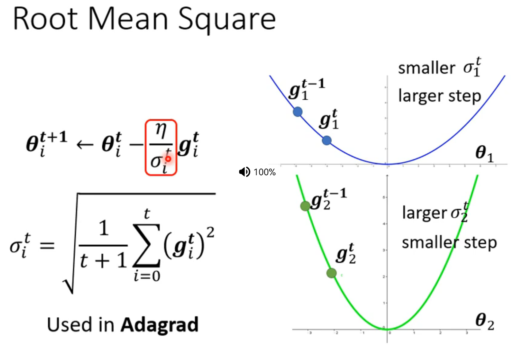

图中用历史梯度平方的均值开方说明尺度调整。图中标注 AdaGrad，但**标准 AdaGrad** 通常累计平方和，而非带 $1/t$ 的均值：

$$
s_t=s_{t-1}+g_t\odot g_t,
\qquad\theta_{t+1}=\theta_t-\eta_t\frac{g_t}{\sqrt{s_t}+\epsilon}.
$$

本文分式、平方与开方均为逐坐标运算。对历史平方和取均值会引入额外的时间尺度因子，不能在固定学习率下视为完全相同的实现。

RMSProp 使用平方梯度的指数移动平均：

$$
v_t=\rho v_{t-1}+(1-\rho)g_t\odot g_t,
\qquad\theta_{t+1}=\theta_t-\eta_t\frac{g_t}{\sqrt{v_t}+\epsilon}.
$$

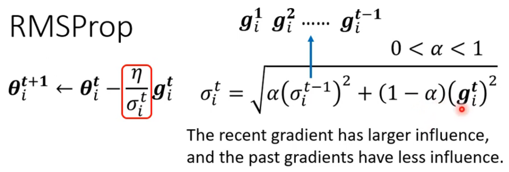

较新的梯度在统计量中占较大权重，旧梯度的影响逐渐衰减。$v_t$ 是平方梯度的平均，属于未中心化的二阶矩估计，不应直接叫作梯度方差；$\epsilon$ 用于数值稳定。

Adam 同时估计一阶矩和二阶矩，并补偿零初始化造成的偏差：

$$
\begin{aligned}
m_t&=\beta_1m_{t-1}+(1-\beta_1)g_t,\\
v_t&=\beta_2v_{t-1}+(1-\beta_2)g_t\odot g_t,\\
\hat m_t&=\frac{m_t}{1-\beta_1^t},\qquad
\hat v_t=\frac{v_t}{1-\beta_2^t},\\
\theta_{t+1}&=\theta_t-\eta_t\frac{\hat m_t}{\sqrt{\hat v_t}+\epsilon}.
\end{aligned}
$$

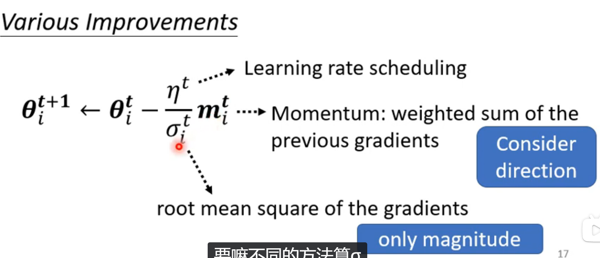

“Adam = Momentum + RMSProp”可用于记忆两个统计量的作用，但完整公式还包含不同衰减率、偏差修正和数值稳定项。

对普通无动量 SGD，L2 梯度给出

$$
\theta_{t+1}=(1-\eta_t\lambda)\theta_t-\eta_tg_t.
$$

因此在相应系数约定下等价于权重衰减。若把 $g_t+\lambda\theta_t$ 送入 Adam，正则项也进入动量与逐坐标缩放，两者通常不再等价。AdamW 使用仅由数据梯度计算的矩估计，再独立施加衰减：

$$
\theta_{t+1}=(1-\eta_t\lambda)\theta_t-
\eta_t\frac{\hat m_t}{\sqrt{\hat v_t}+\epsilon}.
$$

这里的“解耦”是衰减不进入自适应梯度统计，并非衰减数值必然与学习率无关。哪些参数参与衰减需看实现配置，偏置和归一化参数常被单独分组。

| 方法 | 主要记忆量 | 核心作用 | 不应推导出的结论 |
| --- | --- | --- | --- |
| SGD | 当前批梯度 | 沿负梯度方向更新 | 必然找到全局最优 |
| SGDM | 历史方向 | 累积与平滑更新 | 总比 Adam 泛化好 |
| RMSProp | 平方梯度指数平均 | 按坐标调整尺度 | 等于 Momentum |
| Adam | 一阶、二阶矩与偏差修正 | 同时利用方向与尺度 | 永远最快、最后一定震荡 |
| AdamW | Adam 统计量，另加解耦衰减 | 分开处理优化和权重约束 | 所有参数必须同样衰减 |

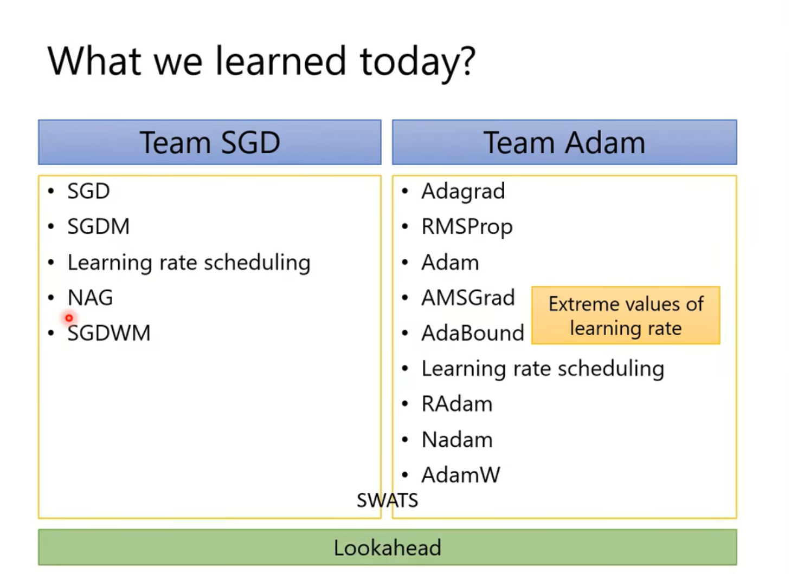

### 2.7 学习率调度、Warmup 与训练稳定性

Learning rate decay 在训练后期降低全局步长，常见有分段、指数、余弦等方式。Warmup 在初期将学习率从较小值逐渐增大，随后可接衰减；调度策略不是优化器本身。

线性 warmup 的一个例子为 $\eta_t=\eta_{\max}\min(1,t/T_w)$，其中 $T_w$ 是 warmup 步数。这只是辅助示例，不能当作课程或所有模型的唯一配置。Warmup 可以缓和初期不稳定、参数尺度变化等问题；Adam 已有偏差修正，不能把 warmup 仅解释成“Adam 刚开始统计不准”。

诊断训练时，需要一起看训练/验证曲线、梯度范数、参数更新幅度、损失实现和数据处理。不要把每次损失上升都归因为局部最小值，也不要只靠更换优化器解释所有故障。

## 3 序列模型：RNN、LSTM 与 GRU

### 3.1 序列为何需要上下文

一句话中词的含义、一个语音帧的类别、时间序列的下一步值，都可能依赖其他位置。仅对每个输入独立应用同一个全连接网络，不能让不同位置交换信息。RNN 使用随时间递推的隐藏状态，把已经处理的上下文带到下一步。

以单层 Elman RNN 为例：

$$
h_t=\phi(W_xx_t+W_hh_{t-1}+b_h),
\qquad o_t=W_yh_t+b_y.
$$

$x_t$ 为当前输入，$h_t$ 为隐藏状态，$o_t$ 为输出分数。各时间步复用相同参数，而不是每个位置另学一套。序列分类可使用最终状态或池化；序列标注则可在各位置输出标签，二者的输出组织方式不同。

**Elman** 网络反馈前一时间步的隐藏状态；**Jordan** 网络反馈前一时间步的输出。原记中的“上一层”应改为“上一时间步”，Elamn 也改为 Elman。Jordan 的“输出”具体是连续网络输出还是经过处理的量，需看模型定义，不应自动等同于训练时喂入真实标签。

双向 RNN 分别按正向和反向处理序列，再拼接或组合两方向的状态。完整输入已知时可利用左右文；严格在线预测不能提前访问未来输入。双向并不意味着单个递推过程同时向两个方向运行。

### 3.2 时间反向传播与长期依赖

RNN 的反向传播称 BPTT，即将共享参数的递推沿时间展开，再应用链式法则。对基础 RNN，跨多步的状态梯度包含：

$$
\frac{\partial h_t}{\partial h_k}
=J_tJ_{t-1}\cdots J_{k+1},\qquad J_j=\frac{\partial h_j}{\partial h_{j-1}},
\qquad
\frac{\partial h_j}{\partial h_{j-1}}
=\operatorname{diag}(\phi'(z_j))W_h.
$$

这里用显式次序写出 Jacobian 的矩阵连乘，避免把一般不交换的矩阵按时间正序相乘。多个 Jacobian 连乘可能导致梯度指数式缩小或放大；共享参数使同一权重在多个时间步参与计算，但“重复使用参数”本身不足以解释具体梯度行为，还取决于激活导数、权重和路径。

梯度爆炸可通过范数裁剪缓解，例如将 $g$ 缩放为 $g\min(1,\tau/\lVert g\rVert_2)$。截断 BPTT 降低计算和内存成本，但也限制跨截断边界直接反传的范围。门控网络为长期信息保留提供了更容易训练的路径。

### 3.3 LSTM 的两个状态和三个门

LSTM 通过显式的 cell state $c_t$ 保存长期信息，通过 hidden state $h_t$ 暴露当前输出。常见的无 peephole 版本，令 $z_t=[h_{t-1};x_t]$：

$$
\begin{aligned}
f_t&=\sigma(W_fz_t+b_f),& i_t&=\sigma(W_iz_t+b_i),\\
o_t&=\sigma(W_oz_t+b_o),& \tilde c_t&=\tanh(W_cz_t+b_c),\\
c_t&=f_t\odot c_{t-1}+i_t\odot\tilde c_t,\\
h_t&=o_t\odot\tanh(c_t).
\end{aligned}
$$

| 量 | 问的是什么 | 接近 0 或 1 时的解释 |
| --- | --- | --- |
| 遗忘门 $f_t$ | 旧记忆保留多少 | 接近 0 丢弃，接近 1 保留 |
| 输入门 $i_t$ | 新候选内容写入多少 | 接近 0 不写，接近 1 允许写入 |
| 输出门 $o_t$ | 当前记忆向外暴露多少 | 控制输出，不能等同于删除 cell 中的记忆 |
| 候选内容 $\tilde c_t$ | 准备写入什么 | 是候选状态，不是第四个 Sigmoid 门 |

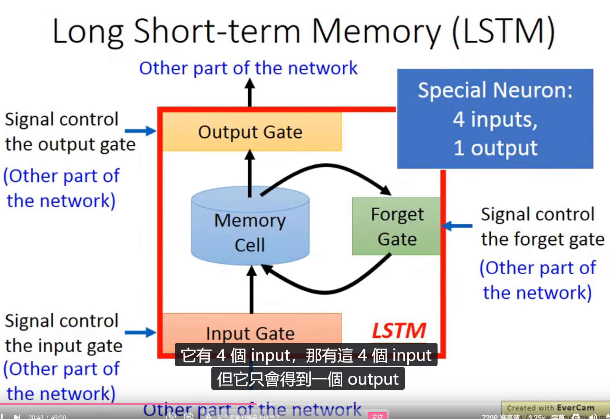

图中的“4 inputs”指候选内容及三个门控信号的四条计算分支，不是每个时间步要提供四组独立外部样本。现代向量化实现常把这些仿射变换合并计算，逻辑作用不变。

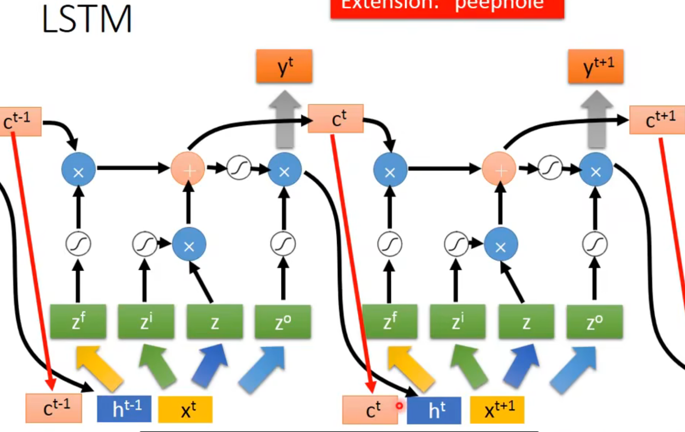

该原图顶端明确写有 **Extension: peephole**，红线表示 cell state 也参与部分门的计算；上面的基础公式没有这些连接。图中记号 $h^t,y^t,c^t$ 也不能不加说明地与所有框架 API 对应。

沿 $c_{t-1}\to c_t$ 的直接记忆路径，其局部导数包含 $f_t$；当门适当地接近 1 时，信息可较长时间保留。完整梯度仍包括其他依赖路径，门会饱和、遗忘门会连乘，因此 LSTM 是缓解长期依赖问题，不是彻底消除梯度消失或爆炸。

### 3.4 GRU 与模型比较

GRU 使用更新门和重置门，通常只维护一个隐藏状态。下面采用原始论文中常见的一种约定：

$$
\begin{aligned}
r_t&=\sigma(W_rx_t+U_rh_{t-1}+b_r),\\
z_t&=\sigma(W_zx_t+U_zh_{t-1}+b_z),\\
\tilde h_t&=\tanh(W_hx_t+U_h(r_t\odot h_{t-1})+b_h),\\
h_t&=(1-z_t)\odot h_{t-1}+z_t\odot\tilde h_t.
\end{aligned}
$$

在此约定中，$z_t$ 越大，新内容占比越大。其他资料可能把 $z_t$ 定义为保留旧状态的权重；一些框架还将重置门放在循环线性变换之后，两种形式一般不能直接视为相同公式。复现时应对照实现，而不是只看变量名字。

| 网络 | 状态 | 门控/变换分支 | 主要取舍 |
| --- | --- | --- | --- |
| 基础 RNN | $h_t$ | 一条候选变换 | 简单，长距离梯度路径较难训练 |
| LSTM | $h_t,c_t$ | 三个门与一个候选 | 分开控制保存、写入和输出，参数较多 |
| GRU | $h_t$ | 两个门与一个候选 | 结构较简洁，通常参数少于同宽 LSTM |

若输入维度为 $D$、隐藏维度为 $H$，每分支只使用一份偏置且没有投影或 peephole，LSTM 循环层约有 $4H(D+H+1)$ 个参数，GRU 约有 $3H(D+H+1)$ 个；某些框架将输入偏置和循环偏置分开存储，计数会不同。GRU 参数较少不保证更不容易过拟合或鲁棒性一定更强，仍需同条件验证。

## 4 Attention 与 Transformer

### 4.1 为什么引入 Attention

RNN 按时间递推，远距离位置的信息要经过较长路径。Attention 让当前位置按内容直接聚合其他位置的信息；Self-Attention 对同一序列内部建立这种联系。它不是单纯求一个“重要性分数”，而是为每个查询产生一组权重，形成上下文化表示。

Self-Attention 本身不规定输入一定是文本。词向量、语音帧、图像 patch 等都可以构成输入序列。全局可见的注意力可以并行处理训练序列，但自回归生成的下一步仍依赖前面已经生成的 token。

### 4.2 Q、K、V 和一次加权聚合

Query 表示当前位置在寻找什么，Key 表示一个位置提供怎样的匹配特征，Value 表示匹配后应聚合的内容。这个类比只辅助理解；三者实际都是可学习投影产生的向量，不是人为赋予的语义标签。

对位置 $i$，点积分数与权重为：

$$
s_{ij}=\frac{q_i^Tk_j}{\sqrt{d_k}},
\qquad \alpha_{ij}=\frac{\exp(s_{ij})}{\sum_{r=1}^{n}\exp(s_{ir})},
\qquad b_i=\sum_{j=1}^{n}\alpha_{ij}v_j.
$$

点积是可训练表示空间中的兼容性评分；在分量近似独立、均值为零、方差约为 1 的启发式条件下，点积方差随 $d_k$ 增大，除以 $\sqrt{d_k}$ 可缓和 Softmax 饱和。这不是要求真实特征永远严格满足该分布。

Softmax 对**同一个 query 对应的所有允许 key**归一化，未施加 dropout 时权重非负且和为 1。再对 Value 加权，是让匹配结果影响真正输出的内容。权重不能自动解释成因果贡献，也不保证某个头必然对应某种人工语义关系。

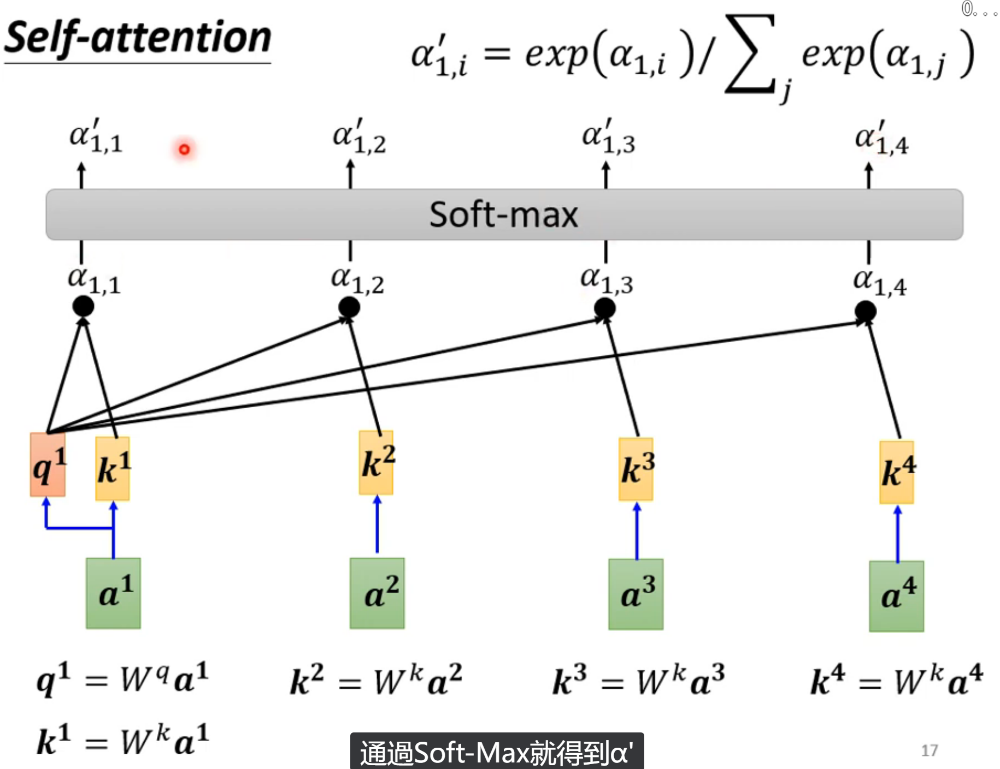

这张图固定第一个 query，与各位置的 key 比较，再经过同一个 Softmax。图中采用列向量 $q^i=W^qa^i$，与下一节的行向量矩阵记法是不同排布约定。

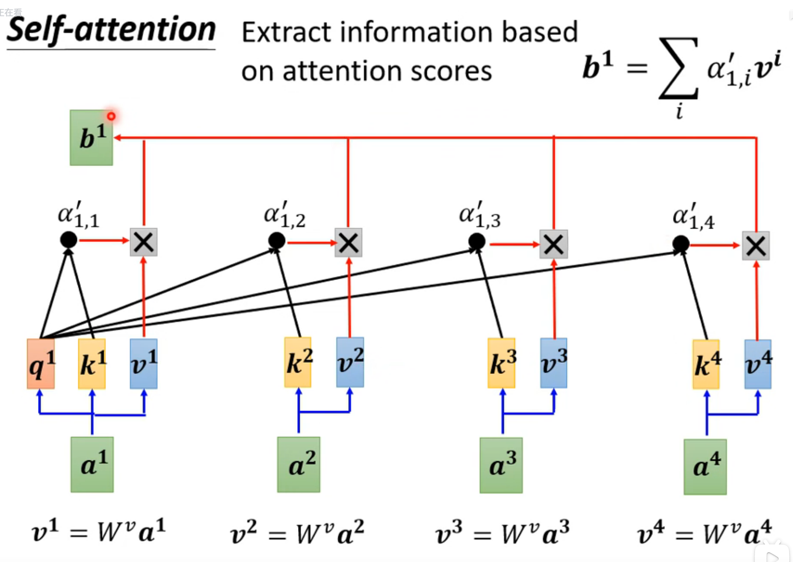

第二张图补全 Value 分支。Q/K 负责权重，V 负责被读取的信息；它们来自同一位置的输入也不意味着投影参数相同。

### 4.3 Scaled Dot-Product Attention 的矩阵形状

本文矩阵计算采用“每行一个 token”，暂省略 batch 和 head 维度。设 $X\in\mathbb R^{n\times d_{\mathrm{model}}}$，则

$$
Q=XW_Q\in\mathbb R^{n\times d_k},\quad
K=XW_K\in\mathbb R^{n\times d_k},\quad
V=XW_V\in\mathbb R^{n\times d_v}.
$$

$$
\operatorname{Attention}(Q,K,V)
=\operatorname{softmax}_{\mathrm{key}}
\left(\frac{QK^T}{\sqrt{d_k}}+M\right)V.
$$

$QK^T$ 为 $n\times n$ 的分数矩阵，Softmax 沿每一行的 key 维归一化，最终输出为 $n\times d_v$。$M$ 是加性掩码：允许处为 0，屏蔽处概念上为 $-\infty$，其 Softmax 权重为 0。实际实现采用稳定的 masked/fused 运算，且要处理整行全部被屏蔽等边界情况。

例如 3 个 token、每个 query/key 长度为 2、每个 value 长度为 4：$Q,K$ 是 $3\times2$，$QK^T$ 是 $3\times3$，输出是 $3\times4$。矩阵乘法混合的是位置，而每个输出仍有一整条内容向量。

### 4.4 多头注意力与位置编码

多头注意力给不同 head 分配各自的投影：

$$
\operatorname{head}_r=\operatorname{Attention}(XW_Q^{(r)},XW_K^{(r)},XW_V^{(r)}),
$$

$$
\operatorname{MHA}(X)=\operatorname{Concat}(\operatorname{head}_1,\ldots,\operatorname{head}_h)W_O.
$$

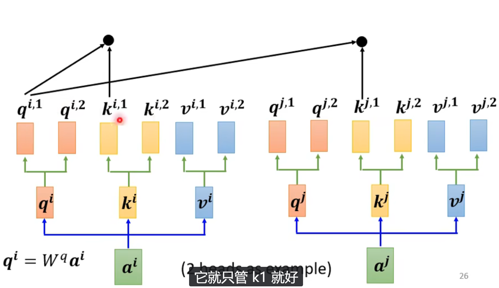

各 head 可以在不同子空间建立关系；拼接后通过 $W_O$ 混合。原图先展示投影再分成多个 head，工程实现也常用一次大线性变换再 reshape；不能理解为把一个已归一化的注意力结果简单复制多份。头越多并不必然越好，固定总维度时每头维度通常也会变小。

不带任何位置机制的全可见 Self-Attention 对位置置换是等变的，无法单靠内容确定词序。原始 Transformer 将 token embedding 与位置编码相加：$x_i=e_{\mathrm{token},i}+p_i$。正弦位置编码的一种形式为

$$
\begin{aligned}
PE(pos,2j)&=\sin\left(pos/10000^{2j/d_{\mathrm{model}}}\right),\\
PE(pos,2j+1)&=\cos\left(pos/10000^{2j/d_{\mathrm{model}}}\right).
\end{aligned}
$$

$pos$ 是位置，$j$ 索引成对的通道。位置表示也可以学习，或者在其他模型中采用相对位置等机制。

### 4.5 Encoder、Residual、FFN 与 LayerNorm

Transformer Encoder 反复叠加“跨位置交流”和“各位置内部变换”：Self-Attention 聚合上下文，position-wise FFN 在各位置独立应用同一组参数。经典 FFN 为 $\operatorname{FFN}(x)=\operatorname{ReLU}(xW_1+b_1)W_2+b_2$。

残差连接 $x+F(x)$ 提供保留原表示和传播梯度的路径，要求相加张量尺寸匹配。LayerNorm 控制每个样本/位置的特征尺度，不负责让不同 token 交换信息。

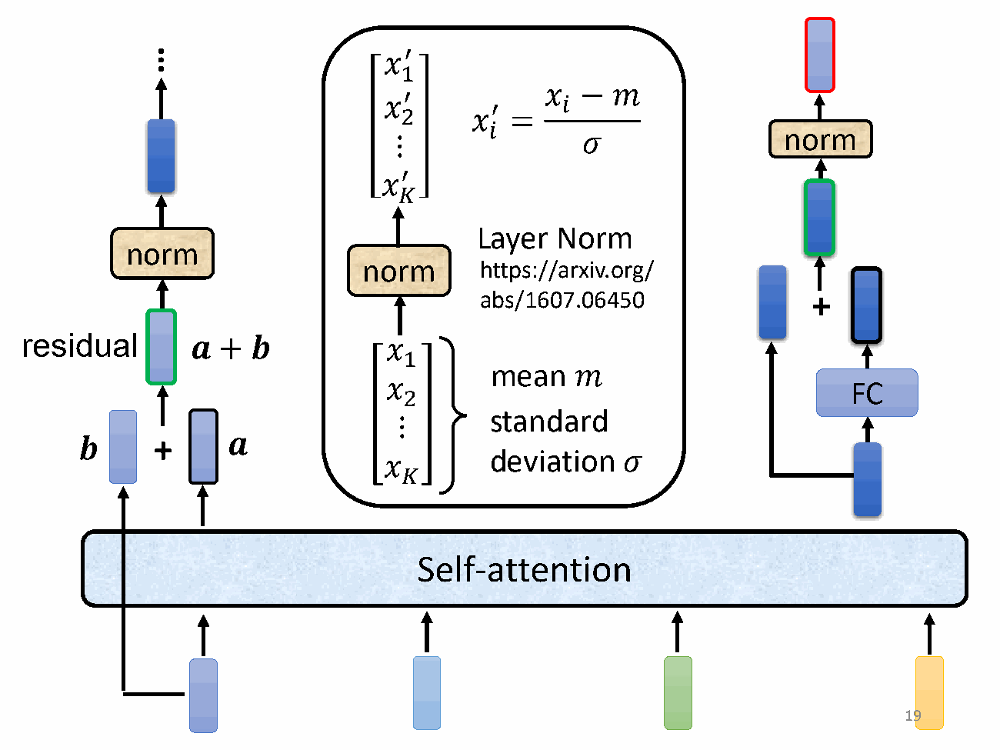

图中先相加再 norm，属于 Post-LN 的展示；中间小图对一条向量内的不同分量计算均值和标准差。

对于常见的 $X\in\mathbb R^{B\times T\times D}$、归一化维度为最后的 $D$ 的情形：

$$
\mu_{b,t}=\frac1D\sum_{j=1}^{D}X_{b,t,j},\qquad
\sigma_{b,t}^2=\frac1D\sum_{j=1}^{D}(X_{b,t,j}-\mu_{b,t})^2,
$$

$$
\operatorname{LN}(X)_{b,t,j}
=\gamma_j\frac{X_{b,t,j}-\mu_{b,t}}{\sqrt{\sigma_{b,t}^2+\epsilon}}+\beta_j.
$$

它沿**同一个 token 的特征维度**统计，不是对“同一特征跨 batch”统计，也不保证输出服从正态分布。$\gamma,\beta$ 是可学习缩放与偏移。若配置的 normalized shape 包含多个末端维度，统计范围随之变化，不能把上述三维张量示例当唯一形式。依据：[LayerNorm 官方文档](https://docs.pytorch.org/docs/2.14/generated/torch.nn.LayerNorm.html)。

常见结构还有 Pre-LN：$x+F(\operatorname{LN}(x))$；Post-LN 则为 $\operatorname{LN}(x+F(x))$。两者训练性质、末端归一化配置等可能不同；对照模型结构时要说明采用哪一种。

### 4.6 三种注意力在 Encoder–Decoder 中的位置

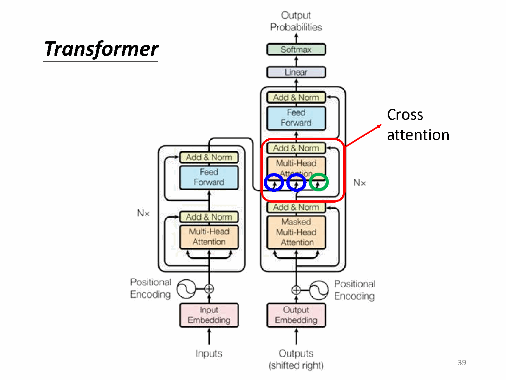

图中结构引自原始 Transformer，课程以红圈强调 Cross-Attention。左侧是 Encoder，右侧 Decoder 有两个注意力子层，顶部再用线性层与 Softmax 预测 token。

| 注意力位置 | Q 来自哪里 | K、V 来自哪里 | 可见范围 | 作用 |
| --- | --- | --- | --- | --- |
| Encoder Self-Attention | Encoder 当前层输入 | 同一层输入 | 源序列所有非 padding 位置 | 编码源端上下文 |
| Decoder Masked Self-Attention | Decoder 该子层输入 | 同一子层输入 | 目标前缀中当前及此前位置 | 建模已知目标历史 |
| Encoder–Decoder Cross-Attention | Decoder 前一子层的目标表示 | Encoder 最终输出，经本层各自投影 | 源序列允许位置 | 按目标需求读取源端信息 |

Cross-Attention 中若目标长 $m$、源长 $n$，则 $Q\in\mathbb R^{m\times d_k}$，$K\in\mathbb R^{n\times d_k}$，$V\in\mathbb R^{n\times d_v}$，权重为 $m\times n$。原记“decoder 输入作为 Q”应精确为该层 Cross-Attention 接收到的 Decoder 隐状态，而不是永远使用原始词嵌入。

Padding mask 屏蔽填充位置；causal mask 屏蔽目标端未来位置，两者用途不同。通常源端编码器不需要因果遮罩，但具体任务可以另设可见性约束。

### 4.7 Teacher Forcing 与自回归生成

自回归模型将条件概率分解为：

$$
p_\theta(y_{1:T}\mid x)=\prod_{t=1}^{T}p_\theta(y_t\mid y_{<t},x).
$$

Teacher forcing 训练时使用**真实前缀**预测下一个 token。若目标是 `机 器 学 习 <EOS>`，输入右移为 `<BOS> 机 器 学 习`；第一个位置应预测“机”，而不是复制同位置真实目标。

$$
L_{\mathrm{seq}}=-\sum_{t=1}^{T}\log p_\theta(y_t\mid y_{<t},x).
$$

训练时目标序列已知，可以在右移输入加上因果遮罩后并行计算各位置损失。遮罩允许注意到当前输入位置，因为该输入已经右移，并非要预测的真实 token；因此“只能看自己和前面”必须和右移约定一起理解。

推理时只有 `<BOS>` 和已生成前缀，逐步选择下一个 token，遇到 `<EOS>` 或长度上限停止。Teacher forcing 的条件分布与模型自己生成前缀时不同，可能造成 exposure bias；出现错误后，后续条件也可能偏离训练分布。

### 4.8 Beam Search、采样与其他 Seq2Seq 补充

贪心解码每步取当前概率最大的 token。Beam search 保留 $K$ 条候选前缀，每步扩展并根据累计得分筛选；通常使用对数概率之和避免概率连乘下溢。

$$
\operatorname{score}(y_{1:t})=\sum_{j=1}^{t}\log p_\theta(y_j\mid y_{<j},x).
$$

首步 A 的概率 0.6、B 的概率 0.4，不足以判断最佳完整序列：若第二步最佳条件概率分别为 0.1、0.9，两条完整路径概率分别为 0.06、0.36。例子说明局部选择与整体得分不同；固定宽度的 beam 仍会丢弃路径，**不保证全局最优**。实际还需管理已完成候选，并可能进行长度归一化，避免偏好过短序列。

| 内容 | 核心思想 |
| --- | --- |
| Non-Autoregressive，NAT | 减少或取消逐 token 依赖以并行生成，需要处理长度预测和多解问题 |
| Copy mechanism | 为姓名、专有词等设计从输入复制的通道，可与词表生成结合 |
| Guided attention | 对特定任务的对齐施加先验，例如语音中的近似单调关系 |
| Sampling | 从模型分布抽样以增加生成多样性；与 beam 的高分候选搜索目标不同 |
| 评测指标与训练目标 | token 交叉熵与 BLEU 等序列指标不同；不可微指标需其他优化方式 |
| Scheduled sampling | 尝试缓解训练/推理前缀差异，具体方法及训练偏差需单独分析 |

## 5 注意力的计算优化

### 5.1 复杂度与稀疏连接

对长为 $n$ 的序列，直接构造全注意力矩阵需要 $n^2$ 个位置对；按常规密集实现，主要注意力乘法时间为 $O(n^2d)$，显式权重矩阵内存为 $O(n^2)$，另有投影等成本。这里描述的是矩阵显式物化的常规实现，不把矩阵大小直接等同于所有实现的峰值显存。

| 思路 | 减少的计算或表示 | 代价与条件 |
| --- | --- | --- |
| Local attention | 只连接附近窗口 | 直接远距离联系减少，需要堆叠或其他通路 |
| Stride / 稀疏 attention | 按间隔等规则选连接 | 需要有适合任务的连接模式 |
| Global token | 少量特殊位置汇集并广播全局信息 | 不能让所有位置都变成全局，否则又接近全连接 |
| 聚类 / 路由 | 优先计算相似 query/key 的配对 | 近似路由可能遗漏关系，路由本身也有成本 |
| 学习稀疏模式 | 用可学习模块选择连接或排序 | 选择操作与训练开销必须纳入总成本 |
| 压缩 key/value | 用较少代表向量代替所有位置，如 Linformer 的思路 | 会改变或近似信息聚合，需要选择压缩维度 |

局部窗口宽度固定为 $w$ 时，连接数可由 $n^2$ 降为约 $nw$；全局 token 数为固定 $g$ 时，额外连接约为 $ng$。这些复杂度结论依赖窗口和全局位置数量不随 $n$ 同阶增长。

### 5.2 线性注意力：何时能交换计算顺序

忽略 Softmax 时，矩阵乘法具有结合律：

$$
(QK^T)V=Q(K^TV).
$$

右侧先得到与序列长度无关的特征维矩阵，可能避免构造 $n\times n$ 中间量。**标准 Softmax 不能直接穿过乘法或随意拆开**，因此不能写成 $\operatorname{softmax}(QK^T)V=Q(K^TV)$。

一种核化线性注意力将相似度改写或近似为 $\phi(q_i)^T\phi(k_j)$，再计算：

$$
b_i=
\frac{\phi(q_i)^T\left(\sum_{j=1}^{n}\phi(k_j)v_j^T\right)}
{\phi(q_i)^T\left(\sum_{j=1}^{n}\phi(k_j)\right)}.
$$

令特征映射输出维度为 $r$，分子中可复用 $r\times d_v$ 的汇总矩阵。固定 $r,d_v$ 时，主要聚合计算随 $n$ 线性增长；分母不可遗漏，实现还需保证合适的核特性并处理数值稳定性。因果情形使用前缀累计，而不能让汇总量包含未来位置。参考：[Linear Transformer 原论文](https://arxiv.org/abs/2006.16236)。

### 5.3 方法比较的边界

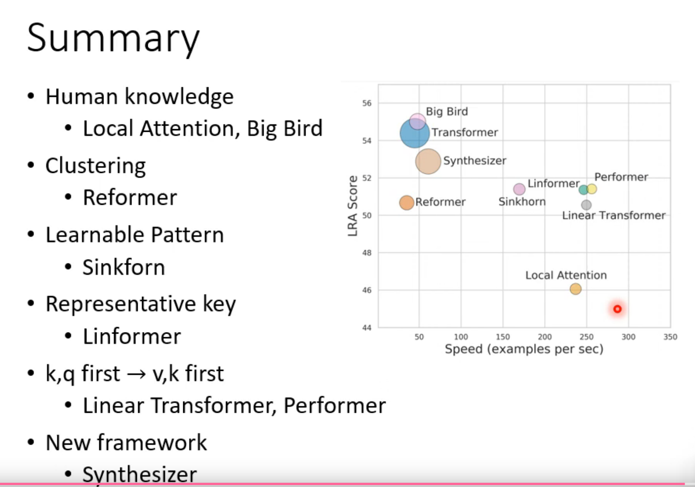

原图归纳了 Local/BigBird、Reformer、可学习模式、Linformer、Linear Transformer/Performer、Synthesizer 等路线。它是课程采用的特定 benchmark 图，不是当前模型排行榜，也不说明某个方法在所有序列长度和硬件上都更快。

Synthesizer 等方法进一步探索不完全依赖显式 Q–K 内容匹配的混合机制。本文保留其核心问题意识，不展开全部论文。比较方法时应统一任务、精度、长度、实现和硬件，并同时看近似误差、实际耗时和显存。

## 6 自监督学习、BERT 与 GPT

### 6.1 从人工标签到预训练

大量文本容易获得，但为每个目标任务收集大量人工标注成本较高。自监督预训练通过预测文本中的一部分，学习可复用表示，再用目标任务数据适配模型。预训练阶段的目标通常不同于最终任务，迁移是否有效仍需验证。

| 阶段/方式 | 使用什么数据 | 更新什么 | 目的 |
| --- | --- | --- | --- |
| 自监督预训练 | 未做目标任务人工标注的原始数据 | 基础模型参数 | 学习通用表示或生成能力 |
| 全参数微调 | 下游任务标注数据 | 大部分/全部基础参数及任务头 | 适配目标任务 |
| 固定特征提取 | 下游数据 | 通常只更新新任务模块 | 使用预训练表示而不调整主干 |
| PEFT | 下游任务数据 | 少量任务相关参数 | 降低每个任务的训练和保存成本 |

ELMo 使用双向语言模型得到上下文化表示，是理解“同一个词可以有不同表示”的历史线索；BERT 使用深层双向 Transformer Encoder，GPT 系列采用因果语言建模。此处只梳理课程中的架构关系，不使用模型规模作为能力的唯一解释。

### 6.2 BERT 的输入与双向上下文

原始 BERT 的输入常组织为 `[CLS] 句子A [SEP] 句子B [SEP]`，由 token embedding、位置 embedding 和 segment/type embedding 相加。单句任务不需要凭空补第二个句子；具体 tokenizer 和输入格式以模型版本为准。

BERT 的 Encoder 在允许的非 padding 输入位置间进行双向 Self-Attention。输入词表查表向量通常不随句子改变，但输出的隐藏状态由上下文共同计算。例如“吃苹果”与“苹果电脑”中，即使同一个 token id 的初始嵌入相同，最终状态也可不同；subword 切分还可能使一个词对应多个位置。

“双向”不等于让模型在训练时直接看到被预测词的正确答案。MLM 先破坏部分输入，再要求模型重建目标；未遮住的左右上下文可以参与预测。

### 6.3 Masked Language Modeling

令 $M$ 为选中的预测位置集合，$\tilde x$ 为经过扰动的输入，则：

$$
L_{\mathrm{MLM}}=-\sum_{i\in M}\log p_\theta(x_i\mid\tilde x).
$$

每个被选位置的输出经过预测头得到词表分布，与原始 token 计算交叉熵；这不是直接输出一条任意长度答案序列。原始 BERT 配方选择约 15% 的 token 位置，其中约 80% 替换为 `[MASK]`、10% 替换为随机 token、10% 保持不变；**80/10/10 是被选位置内部的比例**。后续预训练模型可以采用不同策略。

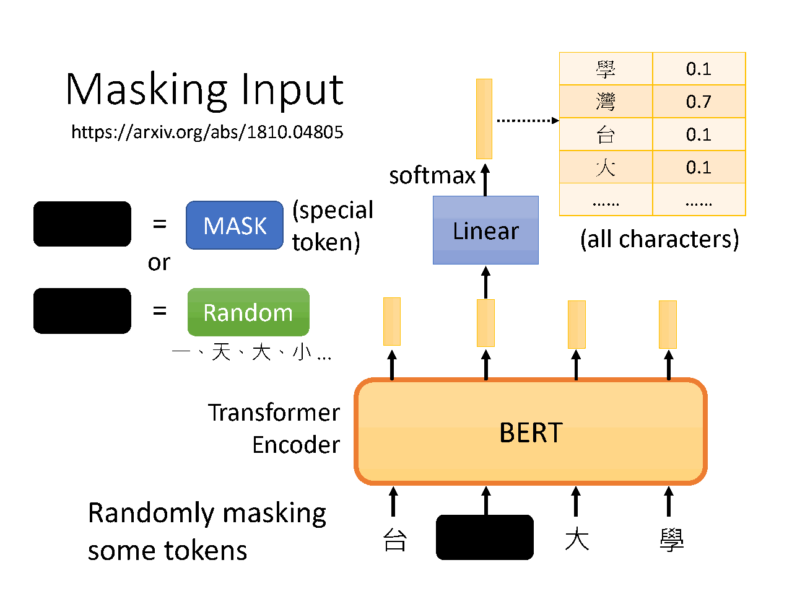

图示展示 Encoder 和被选位置的预测分布，下一页连接真实目标与交叉熵；具体完整掩码比例以上述原始论文配方为准。

### 6.4 NSP、SOP 与模型归属

| 目标 | 所属原始模型 | 正负样本的核心区别 | 希望学习什么 |
| --- | --- | --- | --- |
| NSP，Next Sentence Prediction | BERT | B 是 A 的真实后续文本段，或随机抽取的文本段 | 文本段间关系，但可能被主题等线索简化 |
| SOP，Sentence Order Prediction | ALBERT | 相邻的两个文本段保持正确顺序，或将它们交换 | 文本顺序/篇章连贯性 |

这里的 sentence 在数据处理中常指文本片段，不必严格是一句自然语言句子。原始 BERT 使用 MLM 与 NSP，**不能把 SOP 写成 BERT 原始目标**；SOP 属于 ALBERT。NSP 的随机负样本和 SOP 的交换负样本不等同于“随便打乱所有句子”。

### 6.5 BERT 如何适配四类任务

设最后一层输出为 $H=(h_0,\ldots,h_{n-1})$，$h_0$ 对应 `[CLS]`。最简单的分类头形式如下，实际可增加 pooling、dropout 等模块：

$$
p(y\mid x)=\operatorname{softmax}(Wh_0+b).
$$

| 任务 | 输入与任务头 | 训练目标与注意点 |
| --- | --- | --- |
| 文本分类 | 单句/文本 + `[CLS]` 分类头 | 用任务标签训练；预训练 `[CLS]` 不是自动可靠的通用句向量 |
| 序列标注 | 对各有效 token 的 $h_i$ 接标签分类头 | token 交叉熵；处理 subword 与词级标签对齐，忽略 padding/特殊位置 |
| 句子对分类 | 用分隔符组织 A、B，再接分类头 | 可做蕴含、相关性等，标签含义依任务而定 |
| 抽取式问答 | 问题与文章联合编码，接 start/end 头 | 学习文章内答案片段的起止位置 |

原记将等长词性标注称为 seq2seq，这里改用**序列标注**：它对输入位置给标签，不必引入一个独立自回归 Decoder。把任务类型和网络架构分开，才能判断是否真的需要生成模型。

抽取式 QA 可用两个可训练向量 $w_s,w_e$：

$$
p_s(i)=\frac{e^{w_s^Th_i}}{\sum_{j\in D}e^{w_s^Th_j}},
\qquad
p_e(i)=\frac{e^{w_e^Th_i}}{\sum_{j\in D}e^{w_e^Th_j}},
$$

$$
L_{\mathrm{QA}}=-\log p_s(s^*)-\log p_e(e^*).
$$

$D$ 是可作为答案的文章 token 位置集合，$s^*,e^*$ 为真实边界。解码应满足 $s\le e$，并可限制跨度长度；不能各自取最大概率后不检查合法性。以上是可回答问题的基础形式；不可回答问题需另设无答案机制。模型不能通过这两个位置生成文章之外的新文本。

### 6.6 BERT 为什么有效，以及不能由此推出什么

原记已经解释了上下文对词义的影响。这里进一步把“上下文表示”与“预训练带来的初始化”分开：前者描述网络每次前向计算如何依赖上下文，后者描述训练历史如何使这种表示更有用。仅有同一个 Encoder 架构并不等于已经获得预训练知识。

| 主题 | 应保留的知识 |
| --- | --- |
| 预训练过程分析 | 不同语言现象可能在训练不同阶段出现，不能把某个 probe 分数直接当成人类式理解 |
| 上下文化嵌入 | 同词不同上下文可有不同表示，相关性由数据和目标学习 |
| 跨领域迁移案例 | 讲义展示语言预训练模型迁移到其他序列的研究案例，不能推广为跨领域必然有效 |
| Multilingual BERT | 多语言预训练后可以研究跨语言任务迁移；目标语言无标注不等于预训练没见过该语言 |
| 跨语言表示分析 | 表示可以同时含语言相关和语义信息，不能简单认定不同语言表示完全相同 |

### 6.7 GPT 的自回归目标与上下文学习

设 token 序列为 $x_{1:T}$，因果语言模型优化：

$$
L_{\mathrm{AR}}=-\sum_{t=1}^{T}\log p_\theta(x_t\mid x_{<t}).
$$

它使用因果 Self-Attention，只利用前缀。典型 decoder-only 架构没有单独的源端 Encoder，也不因此自动具有 Encoder–Decoder Cross-Attention。“Decoder-only”描述架构，不要求任务输入一定是机器翻译的目标句。

| 比较项 | 原始 BERT | GPT 类因果语言模型 |
| --- | --- | --- |
| 主体结构 | 双向 Encoder | 因果 Decoder-only |
| 基础预训练目标 | MLM；原始模型另加 NSP | 下一 token 预测 |
| 可用上下文 | 未遮盖的左右文 | 当前预测位置以前的 token |
| 常见任务使用 | 接任务头微调，或利用掩码预测 | 在前缀后续写，也可进行任务微调 |

**In-context learning** 把示例放进输入，不在这一推理过程中执行梯度更新；与拿少量样本微调参数不是一回事。Few-shot 的“shot”计数须说明是提示示例数量还是训练样本数量。二者在第 7 节继续比较。

## 7 高效使用预训练语言模型

### 7.1 两类瓶颈与两种效率

Data-efficient 方法希望在较少下游标注下有效适配；parameter-efficient 方法希望减少每任务需要训练、保存的参数。二者可以结合，但不是同一个指标。训练参数少也不代表基础模型变小，或者推理浮点计算一定同比减少。

全参数微调使模型自由适应新任务，但需要保存较大的任务模型和优化器状态。固定主干并仅训练小模块，可以共享预训练权重；能否保持效果以及需要多少任务样本，仍应实测。

### 7.2 Prompting、Verbalizer 与 Demonstration

Prompting 将任务写成预训练模型熟悉的形式。例如把情感分类改成“这部电影很棒。总体评价是 [MASK]”，再用“好/差”等标签词的概率作分类依据。模板说明任务形式，**verbalizer** 规定词表输出与类别标签如何对应。

Demonstration 提供若干输入—输出示例，帮助模型判断任务和输出格式。若只把这些示例放进推理上下文，就是 in-context learning；如果使用示例更新参数，则是有训练步骤的 few-shot adaptation。

| 名称 | 是否提供目标任务示例 | 是否更新参数 | 需说明的约定 |
| --- | --- | --- | --- |
| Zero-shot 推理 | 通常不给带标签示例，可给任务描述 | 通常不更新 | 不表示模型从未在预训练中遇到相关知识 |
| Few-shot in-context | 输入上下文内放少量示例 | 推理时不更新 | 受示例选择、顺序和上下文长度影响 |
| Few-shot 微调 | 少量带标签训练样本 | 更新全部或部分参数 | 需区分模型选择数据与最终测试数据 |
| Prompt-based 微调 | 把样本转成模板任务 | 可以更新主干 | Prompting 并不天然等于 PEFT |

### 7.3 半监督学习与伪标签

原记的自训练流程是半监督学习的一种：先用少量人工标注训练模型，对额外未标注数据预测，再筛选可信伪标签继续训练。PET 等课程案例也会组合不同模板的预测，产生软标签供后续学习。对应讲义 PDF 第 53–57 页。

伪标签可能放大已有偏差或错误，置信度不等于一定正确。应保留独立验证集，控制阈值与类别分布；不能把最终测试集拿来生成标签再报告测试性能。半监督学习混合标注与未标注数据，自监督学习则强调监督信号如何从数据自身构造，两种分类角度不同。

### 7.4 Adapter、LoRA、Prefix 与 Soft Prompt

| 方法 | 主要训练内容 | 插入/作用位置 | 原主干如何处理 |
| --- | --- | --- | --- |
| Adapter | 小型瓶颈网络，通常另有任务头 | Transformer 层内的指定位置 | 多数主干冻结，细节依设置 |
| LoRA | 低秩增量矩阵，通常另有任务头 | 选定线性变换的增量分支 | 原矩阵冻结 |
| Prefix tuning | 连续前缀及其参数化模块 | 常在各层注意力的 K/V 侧加入前缀 | 主干通常冻结 |
| Soft prompt / prompt tuning | 输入级连续提示向量 | 通常是嵌入输入序列的前缀 | 主干通常冻结 |

表格描述常见版本，不要求所有 PEFT 都新增参数，也不保证所有实现冻结相同的 LayerNorm、偏置或任务头。

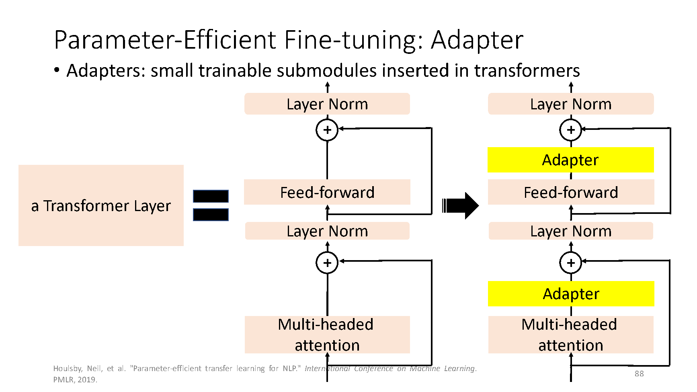

图中在注意力和前馈分支附近添加 Adapter，这是一个具体设计，不代表每种 Adapter 都插在完全相同的位置。瓶颈结构可简写为 $h'=h+W_{\mathrm{up}}\phi(W_{\mathrm{down}}h)$。

LoRA 假设任务需要的权重变化可以用低秩增量有效参数化。采用列向量记法，原矩阵 $W_0\in\mathbb R^{d_{\mathrm{out}}\times d_{\mathrm{in}}}$：

$$
W=W_0+\Delta W,\qquad \Delta W=\frac{\alpha}{r}BA,
$$

$$
A\in\mathbb R^{r\times d_{\mathrm{in}}},\quad
B\in\mathbb R^{d_{\mathrm{out}}\times r},\quad
Wx=W_0x+\frac{\alpha}{r}B(Ax).
$$

冻结 $W_0$，只训练 $A,B$ 等选定参数，增量分支参数数目为 $r(d_{\mathrm{in}}+d_{\mathrm{out}})$，小于全矩阵的 $d_{\mathrm{in}}d_{\mathrm{out}}$，前提是 $r$ 足够小。不同记法可能把两个矩阵的字母反过来，应以形状和乘法顺序为准。

低秩的是**更新 $\Delta W$**，并不是宣称原预训练矩阵 $W_0$ 必然低秩。也不是“每次直接对原矩阵做 SVD 截断”。标准线性增量在条件允许时可合并进 $W_0$ 以供推理；训练时仍需经过基础模型计算，不能把可训练参数减少倍数当作总 FLOPs 的减少倍数。

Prefix 与 Soft Prompt 都使用连续向量，但常见 prefix 在多层注意力中引入任务信息，输入级 soft prompt 通常只在嵌入层加入若干可训练向量。它们不一定能对应成自然语言词，也不是“把人工提示写长一点”。

### 7.5 共享、压缩与 Early Exit

| 路线 | 主要减少什么 | 必须区分的条件 | PDF 页 |
| --- | --- | --- | --- |
| 蒸馏 Distillation | 使用较小学生模型近似较大模型行为 | 学生结构、训练信号与数据会影响效果 | 72 |
| 剪枝 Pruning | 去除部分权重或结构 | 稀疏参数少不保证普通硬件自动加速 | 72 |
| 跨层参数共享 | 多层复用权重，如 ALBERT 相关设计 | 参数少与实际层数/计算量少不是一回事 | 73 |
| PEFT | 每任务的可训练/保存参数 | 完整主干仍需可用 | 75–105 |
| Early exit | 简单样本经过的推理层数 | 要有出口预测及可靠的退出判据 | 107–114 |

Early exit 是根据中间层结果提前结束**推理**，Early stopping 是根据验证表现提前结束**训练**，两者不能混淆。
